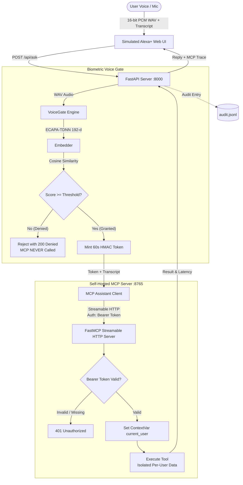
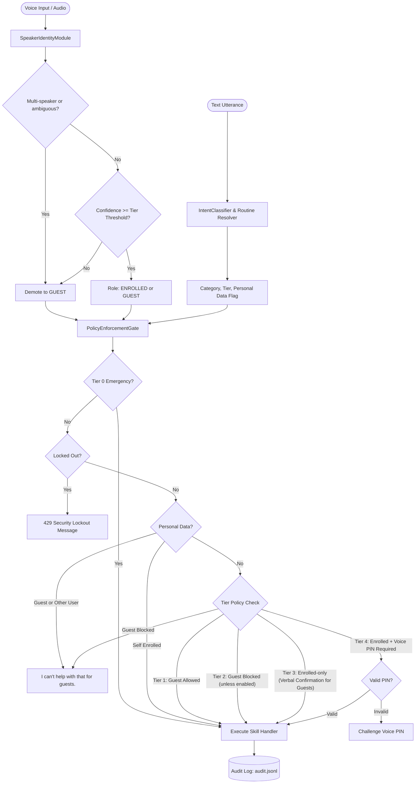

# Voice Gate for Alexa+

> **A speaker-verified AI assistant experience protected by a self-hosted Model Context Protocol (MCP) server.**

[](LICENSE)
[](https://www.python.org/)
[](https://modelcontextprotocol.io/)
[](tests/)

---

## 1. Overview & Problem

In shared environments (living rooms, kitchens, collaborative offices), voice assistants suffer from **ambient voice vulnerability**: anyone within physical hearing range—a child, guest, prankster, or TV audio—can issue commands. With modern agentic assistants powered by **Model Context Protocol (MCP)** tools, this allows unverified speakers to trigger smart home devices, inspect private reminders, or alter thermostats.

**Voice Gate for Alexa+** solves this by inserting a cryptographic speaker-recognition gate in front of the assistant:
1. **Biometric Verification**: Evaluates microphone audio against enrolled speaker centroids using **SpeechBrain ECAPA-TDNN** neural embeddings.
2. **Short-Lived Bearer Tokens**: An HMAC-SHA256 token (60s TTL) is minted **only** when the voice match meets or exceeds the cosine similarity threshold (default `0.40`).
3. **Protected MCP Server**: Tools run on a self-hosted MCP server over **Streamable HTTP** (protocol version `2025-11-25+`) and strictly reject unauthenticated requests with HTTP `401 Unauthorized`.
4. **ContextVar Identity Isolation**: Caller identity is extracted by middleware and injected into a thread-safe `contextvars.ContextVar`. Tools retrieve identity from server context, **never** from LLM or client arguments.

> [!NOTE]
> **Simulated Alexa+ Notice**: This project provides a simulated Alexa+ web experience. Commercial Alexa hardware handles speech capture and cloud speech recognition internally, without exposing raw PCM audio buffers to third-party skills. A full-fidelity simulated environment is required to provide the raw audio necessary for custom neural speaker verification while showcasing real, spec-compliant MCP server tooling.

---

## 2. Architecture



---

## 3. Quick Start (One-Command Run)

### Prerequisites
- Python 3.10 or higher
- Git
- Web browser (Google Chrome recommended for native Web Speech API support)

### Installation
```bash
# 1. Clone repository
git clone https://github.com/<YOUR_GITHUB_USERNAME>/voice-gate-alexa-plus.git
cd voice-gate-alexa-plus

# 2. Create and activate virtual environment
python -m venv .venv

# On Linux/macOS:
source .venv/bin/activate
# On Windows PowerShell:
.venv\Scripts\Activate.ps1
# On Windows Command Prompt:
.venv\Scripts\activate.bat

# 3. Install dependencies
pip install -r requirements.txt
```

### Run
Launch both the MCP server and FastAPI app concurrently with one command:
```bash
python run.py
```
*(On Windows systems where `python` redirects to Microsoft Store, use `py -3.10 run.py`)*

Output:
```text
[run.py] Starting MCP Server...
[run.py] Starting FastAPI App...
[run.py] Voice Gate running!
  Web UI  : http://localhost:8000/
  API     : http://localhost:8000/docs
  MCP     : http://127.0.0.1:8765/mcp
```

Open your browser to **`http://localhost:8000`**.

---

## 4. How to Enroll and Test

1. **Enroll your voice**:
   - In the web UI, open the **Enroll Voice** tab.
   - Enter your name (e.g. `alice`).
   - Check the mandatory biometric consent box: *"I consent to storing my voiceprint"*.
   - Read the 4 prompted sentences aloud, clicking **Record clip** for each (records ~3 seconds of speech).
   - Click **Submit enrollment**. Your voiceprint centroid is now saved.
2. **Test Authorized Access**:
   - In the **Assistant** tab, click and hold **Hold to Speak** (or click once to toggle).
   - Say: *"What time is it?"* or *"Remind me to submit the hackathon project"*.
   - The central orb will glow **Emerald Green (Granted)**, display your similarity score (e.g., `96.2%`), and speak the reply.
   - Inspect the **MCP Activity** side panel: view the exact MCP tool call, parameters, returned payload, and latency.
3. **Test Impostor / Unknown Voice Rejection**:
   - Have another person speak, or speak with an altered voice / synthetic sample: *"Turn on the living room light"*.
   - The orb pulses **Red (Denied)** with a low similarity score.
   - The assistant replies: *"Voice not recognized."*
   - Verify that **NO MCP tool call is made**. The MCP activity stream remains clean.
4. **Test Unauthenticated MCP Protection directly**:
   ```bash
   curl -X POST http://localhost:8765/mcp
   # Returns: {"error": "Missing or malformed Authorization header"} (HTTP 401)
   ```

---

## 5. Configuration Options

All options are configurable via environment variables or a `.env` file:

| Variable | Default | Description |
| :--- | :--- | :--- |
| `VOICEGATE_THRESHOLD` | `0.40` | Cosine similarity threshold for granting access (`0.0` to `1.0`). |
| `VOICEGATE_SECRET` | *(Random)* | HMAC-SHA256 secret for token signing. Random per start if unset. |
| `VOICEGATE_TOKEN_TTL` | `60` | Lifespan of issued token in seconds before expiry. |
| `VOICEGATE_DATA` | `voiceprints` | Directory where `.npy` speaker centroid embeddings are stored. |
| `VOICEGATE_LIVENESS` | `0` | Set to `1` to require repeating a random 3-word challenge phrase. |
| `VOICEGATE_LLM` | `none` | Planner mode: `none` (deterministic regex router), `openai`, or `anthropic`. |
| `APP_PORT` | `8000` | Port for FastAPI web application. |
| `MCP_PORT` | `8765` | Port for self-hosted Streamable HTTP MCP server. |

---

## 6. MCP Server & Tool Isolation

The self-hosted MCP server exposes 17 speakable, per-user tools on `http://127.0.0.1:8765/mcp`:
- **Personal Schedule (Feature A)**: `get_schedule(day, owner)`, `get_next_event(owner)`, `add_event(title, when, time_str, owner)`.
- **Personalized Greetings**: `greeting()` returning time-of-day greeting addressed to verified speaker.
- **Reminders & Lists**: `add_reminder`, `list_reminders`, `add_to_shopping_list`, `read_shopping_list`, `add_to_list`, `read_list`.
- **Routines & Automations**: `run_routine(routine_name)`.
- **Smart Home & Devices**: `control_device`, `set_timer`, `get_time`, `get_weather_stub`.
- **Cross-User Sharing Controls (Feature B)**: `set_sharing_policy(category, level, audience)`, `get_sharing_policies()`, `revoke_sharing_policy(category)`.

### Zero-Trust User Isolation & Default-Deny Sharing
1. **ContextVar Caller Identity**: MCP tools **never accept the caller username as a client argument**. The caller identity is derived strictly from the verified Bearer token by `BearerTokenMiddleware` and injected into `contextvars.ContextVar("current_user")`.
2. **Centralized `authorize()` Choke Point**: Any tool call referencing another user's data (e.g. `get_schedule(owner="rahul")`) routes strictly through `mcp_server.sharing.authorize()`.
3. **Default-Deny Model**: Sharing is strictly OFF for all categories unless an enrolled owner explicitly grants `read` or `read_write` access.
4. **Tier 4 Unshareable Protection**: Categories such as banking, payments, and account PINs can never be shared across users under any circumstance.
5. **Cross-User Audit Trail**: Every cross-user access attempt (allowed or denied) is immutably logged to `data/_sharing_audit.jsonl` and viewable in the UI or via `/api/sharing/audit`.

---

## 7. Running the Automated Test Suite

The test suite runs 100% offline without requiring GPUs, cloud credentials, or heavy neural network downloads, using our synthetic audio fixture and mock embedder:

```bash
# Run full pytest suite
pytest -v
```

### Verified Test Categories:
- **`tests/test_sharing.py`**: Per-user personal schedule isolation, default-deny sharing, audience filtering, read-only vs read-write protection, Tier 4 unshareable enforcement, cross-user audit trail, and `/api/sharing` REST endpoints.
- **`tests/test_voice_gate.py`**: Enrollment clip validation ($\ge 3$), name regex, cosine threshold verification, multi-speaker selection, short-clip rejection.
- **`tests/test_tokens.py`**: HMAC-SHA256 minting, signature verification, tampering detection, and 60-second expiration.
- **`tests/test_tools_isolation.py`**: Per-user data partitioning across tools; unauthenticated execution rejection.
- **`tests/test_mcp_auth_and_protocol.py`**: MCP server 401 rejections on missing/expired tokens; Streamable HTTP protocol negotiation $\ge 2025-11-25$.
- **`tests/test_api_server.py`**: End-to-end FastAPI integration verifying unknown voices **never reach the MCP server**, sliding-window brute-force rate limiting, and audit logging.
- **`tests/test_access_control.py`**: Tier 0 to Tier 4 sensitivity mapping, voice PIN verification, and guest permissions.

---

## 8. Threshold Evaluation Tool (`scripts/eval_threshold.py`)

A standalone benchmarking script evaluates False Acceptance Rate (FAR) and False Rejection Rate (FRR) across similarity thresholds:

```bash
# Run benchmark on synthetic dataset
python scripts/eval_threshold.py --synthetic

# Run benchmark on your own dataset of speaker folders:
# (e.g. data/speaker_1/*.wav, data/speaker_2/*.wav)
python scripts/eval_threshold.py --data-dir path/to/dataset
```

The script prints the genuine and impostor distribution metrics, outputs the Equal Error Rate (EER) threshold, and displays a recommended `VOICEGATE_THRESHOLD` value.

---

## 9. Privacy & Ethical Guardrails

- **No Raw Audio Storage**: Raw audio buffers are strictly processed in-memory and discarded. Only 192-dimensional floating-point embeddings are saved to disk.
- **Explicit Biometric Consent**: Enrolling a voice requires ticking the biometric disclosure checkbox (`consent=true`), stored in compliance with privacy best practices.
- **Instant Revocation**: Any user can delete their biometric voiceprint immediately using the 1-click **Delete** button in the UI or via `DELETE /api/users/{name}`.
- **Sanitized Audit Log**: `audit.jsonl` logs timestamp, outcome (`GRANTED`/`DENIED`), user, score, and client IP. Speech audio is never written to log files.

---

## 10. Known Limitations

- **Replay Attacks**: Standard cosine similarity matching does not inherently distinguish between live speech and high-fidelity speaker recordings. Enable challenge-phrase mode (`VOICEGATE_LIVENESS=1`) to mitigate static replays.
- **Microphone Variance**: Low-quality or clipping laptop microphones can alter high-frequency harmonics; enrollment should be conducted on the same microphone used for inference.
- **Acoustic Noise**: High background noise or overlapping voices can degrade similarity scores.

---

## 11. Docker Deployment (Optional)

Run the containerized stack in one command:
```bash
docker compose up --build
```
Access the application at `http://localhost:8000`. Voiceprints and models are mounted to `./voiceprints` and `./pretrained_models` on the host.

---

## 12. Voice-Identity-Based Access Control Layer

A modular permission layer sitting between speaker recognition and assistant skills, ensuring users and guests only access permitted features and data.

### Architecture Flow



### Sensitivity Tier Matrix

| Tier | Sensitivity Level | Guest Default | Enrolled Configurable? | Verification & Security Requirements | Included Categories |
| :--- | :--- | :--- | :--- | :--- | :--- |
| **Tier 0** | **Emergency** | **Allowed** | ❌ Immutable | Exempt from confidence gating. Always allowed for everyone. | Emergency ("call 911", "I need help", "call ambulance") |
| **Tier 1** | **Guest-Allowed** | **Allowed** | ✅ Yes (Can disable) | Normal confidence threshold (`>= 0.40`). | Music & Entertainment, General Information (weather, news, recipes, facts) |
| **Tier 2** | **Guest-Blocked** | **Blocked** | ✅ Yes (Can enable) | Normal confidence threshold (`>= 0.40`). | Smart Home Control (lights, plugs, thermostat), Video & TV, Generic Timers, Allow-listed Skills |
| **Tier 3** | **Enrolled-Only** | **Blocked** | ⚠️ Yes (Requires PIN / verbal confirmation + risk warning) | High confidence (`>= 0.65`). Personal data portions strictly stay blocked. | Communication & Intercom, Home Security (locks, garage, alarm), Shopping, Routines, Kids/Family |
| **Tier 4** | **Restricted Admin** | **Blocked** | ❌ Immutable | Very High confidence (`>= 0.80`) + Voice PIN (Second Factor). | Payments & Banking, Food/Ride Ordering, Device Settings, Guest Permission Management |
| **Personal Data** | **Per-User Isolated** | **Blocked** | ❌ Immutable | Strictly restricted to owning user. Zero info leakage on refusals. | Calendar, Reminders, Notes, Email, Contacts, Orders, Location History |

### How to Plug In Your Real Speaker Recognition Model

Connect your black-box model `identify_speaker(audio) -> {"user_id": str | None, "confidence": float}` into the gate:

```python
from access_control import PolicyEnforcementGate, SpeakerIdentityModule, SpeakerIdentificationResult

# 1. Your existing model function
def my_speaker_model(audio_data):
    # Calls your neural model / ECAPA-TDNN embedder
    user_id, confidence = my_detector.predict(audio_data)
    return {"user_id": user_id, "confidence": confidence}

# 2. Attach adapter to the access control gate
speaker_module = SpeakerIdentityModule(model_fn=my_speaker_model)
gate = PolicyEnforcementGate()

# 3. Process an incoming voice request
speaker_result = speaker_module.process_audio(audio_buffer)
decision = gate.process_request(
    utterance="unlock the front door",
    speaker_result=speaker_result,
    pin_attempt="1234" # optional PIN if challenged
)

print(decision.allowed)          # True or False
print(decision.response_message) # Spoken response or polite refusal
```

### Running the Simulator

Test any scenario immediately without needing audio files:

```bash
# 1. Test guest attempting to unlock front door (Tier 3 - Denied with polite refusal)
python simulator.py "speaker=guest, confidence=0.4, utterance='unlock the front door'"

# 2. Test emergency call at 0 confidence (Tier 0 - Always Allowed)
python simulator.py "speaker=guest, confidence=0.0, utterance='call 911'"

# 3. Test enrolled user granting smart home access to guests using Voice PIN
python simulator.py --speaker gauravi --confidence 0.95 --pin 1234 --utterance "Allow guests to use smart home control"

# 4. Interactive REPL simulator mode:
python simulator.py
```

### Running the Access Control Test Suite

```bash
python -m pytest tests/test_access_control.py -v
```

---

## 13. License & Open Source

This project is licensed under the **MIT License**. See [LICENSE](LICENSE) for details.

